# ShopVerse

A production-style, full-stack e-commerce marketplace with three roles (customer, seller, admin), image uploads, timed discounts with live countdowns, Stripe payments and order management.

**Live:** https://shopverse-mahadi.vercel.app/ · **Repo:** https://github.com/mmahadi-ahmedd/ShopVerse

> **Reading guide.** Developers: sections 1–8. QA engineers: sections 9–15 (test accounts, test strategy, test cases, API reference, defects found, known limitations).

## Contents
1. [Overview and features](#1-overview-and-features)
2. [Tech stack](#2-tech-stack)
3. [Architecture and project structure](#3-architecture-and-project-structure)
4. [DynamoDB design](#4-dynamodb-design)
5. [Environment variables](#5-environment-variables)
6. [AWS and Stripe setup](#6-aws-and-stripe-setup)
7. [Installation](#7-installation)
8. [Deployment](#8-deployment)
9. [QA: environment and test accounts](#9-qa-environment-and-test-accounts)
10. [QA: test strategy](#10-qa-test-strategy)
11. [QA: test cases](#11-qa-test-cases)
12. [QA: requirements traceability](#12-qa-requirements-traceability)
13. [QA: API reference](#13-qa-api-reference)
14. [QA: defects found and fixed](#14-qa-defects-found-and-fixed)
15. [Known limitations](#15-known-limitations)
16. [Screenshots](#16-screenshots)

---

## 1. Overview and features

**Storefront**
- Responsive homepage: hero, perks, category cards, hot deals, new arrivals, reviews, newsletter
- Product listing with search, category and price filters, cursor pagination
- Product detail with image gallery and related products
- Cart (add, update quantity, remove, live subtotal, stock limits) and wishlist (no duplicates)
- Stripe Checkout (test mode) and order history
- About page with FAQ and contact, 404 page, loading / empty / error states

**Discounts and offers**
- Sellers create timed discounts: product, percentage, temporary image, exact start and end date-time
- Cards show the temporary image, a badge and a crossed-out price; the detail page shows the validity window and a live countdown; the cart and checkout use the discounted price
- The admin picks **one** discount to feature in the homepage offer popup, which has its own live countdown

**Roles**

| Role | Can do |
|---|---|
| Customer | Browse, cart, wishlist, checkout, view own orders |
| Seller | Manage own products (with image upload), create and delete own discounts, see paid orders containing own items and total sales |
| Admin | Overview stats and 7-day revenue chart, manage categories, products and users, feature a discount, update order status |

## 2. Tech stack
Next.js 16 (App Router) · React · TypeScript · Tailwind CSS v4 · AWS DynamoDB · AWS S3 · Stripe · Zod · JWT (`jose`) · bcrypt · Vitest

## 3. Architecture and project structure

```
User → Next.js app (React UI) → Route Handlers → Services (business logic) → Repositories → DynamoDB
                                     └─ browser uploads images directly to S3 via presigned URLs
                                     └─ Stripe Checkout (hosted page) + webhook → order confirmation
```

```
src/
  app/            Pages and route handlers: (store), admin, seller, dashboard, api
  components/     Reusable UI components
  services/       Business logic and validation (auth, catalog, cart, discounts, orders, stats)
  lib/            Auth/session, S3, Stripe, and lib/db/* repositories (all DynamoDB access)
  types/          Shared TypeScript types
  utils/          Error handling, slugs, formatting
  proxy.ts        Role-based page protection
scripts/          create-table.ts, seed-admin.ts
```

**Design decisions**
- **Layering:** the UI never touches the database. Handlers validate input and delegate to services; only repositories talk to DynamoDB.
- **Auth:** stateless JWT in an httpOnly cookie. Roles are enforced twice: in `proxy.ts` for pages and with `requireRole()` in every API handler.
- **Scalability:** on-demand DynamoDB capacity, query-by-key access patterns (no scans on hot paths), direct-to-S3 uploads so the server never handles image bytes, cursor pagination, stateless server.
- **Data integrity:** conditional writes for unique emails and wishlist duplicates; a transaction marks an order paid and decrements stock atomically (guarded by `stock >= qty`); order lines snapshot the price at purchase; the payment is refunded automatically if stock runs out while the customer is paying.
- **Error handling:** one `route()` wrapper converts validation errors (400), application errors (`AppError`, with its own status) and unexpected failures (500, logged, generic message) into consistent JSON.

## 4. DynamoDB design

Single table `shopverse` (PK, SK), three global secondary indexes (each with its own key pair), on-demand billing.

| Entity | PK | SK | Indexes |
|---|---|---|---|
| User | `USER#id` | `PROFILE` | |
| Email lock (uniqueness) | `EMAIL#email` | `USER` | |
| Category | `CATEGORY#id` | `META` | GSI1: `CATEGORIES` |
| Product | `PRODUCT#id` | `META` | GSI1: `PRODUCTS` · GSI2: `CAT#categoryId` · GSI3: `SELLER#sellerId` |
| Cart item | `USER#id` | `CART#productId` | |
| Wishlist item | `USER#id` | `WISH#productId` | |
| Discount | `DISCOUNT#id` | `META` | GSI1: `DISCOUNTS` · GSI2: `PRODDISC#productId` · GSI3: `SELLERDISC#sellerId` |
| Order | `ORDER#id` | `META` | GSI1: `ORDERS` · GSI2: `USERORD#userId` |
| Order seller group | `ORDER#id` | `SELLER#sellerId` | GSI3: `SELLERORD#sellerId` |
| Featured offer | `CONFIG` | `FEATURED_DISCOUNT` | |
| Newsletter | `NEWSLETTER#email` | `SUB` | |

**How the application reads, creates, updates and deletes data**

| Operation | Access pattern |
|---|---|
| Read product, category, user | `GetItem` by key |
| List products | `Query` on GSI1 (all), GSI2 (by category) or GSI3 (by seller) with filter expressions for search and price; sorted newest first |
| Create user | `TransactWrite`: email lock (conditional) + profile |
| Create / update / delete product | `PutItem` / `DeleteItem`; ownership checked in the service |
| Cart | `Query` PK + `begins_with(CART#)`; `PutItem` / `DeleteItem` per line; prices read live from products |
| Wishlist | conditional `PutItem` (`attribute_not_exists`) prevents duplicates |
| Create discount | overlap check via `Query` on GSI2, then `PutItem` |
| Place order | `TransactWrite`: order + one group item per seller |
| Confirm payment | `TransactWrite`: status `pending_payment` → `paid` + `stock = stock - qty` guarded by `stock >= qty` |

## 5. Environment variables

Copy `.env.example` to `.env.local`. Never commit real values.

| Variable | Description |
|---|---|
| `AWS_REGION` | Region of the DynamoDB table and S3 bucket |
| `AWS_ACCESS_KEY_ID`, `AWS_SECRET_ACCESS_KEY` | IAM user credentials (DynamoDB + S3 only) |
| `DDB_TABLE` | DynamoDB table name (`shopverse`) |
| `S3_BUCKET` | Public-read bucket for product images |
| `CDN_URL` | Base URL of the bucket (or CloudFront) |
| `JWT_SECRET` | Random secret, 32+ characters |
| `APP_URL` | Public URL of the app (Stripe redirects) |
| `STRIPE_SECRET_KEY` | Stripe **test** secret key |
| `STRIPE_WEBHOOK_SECRET` | Webhook signing secret (production) |
| `ADMIN_EMAIL`, `ADMIN_PASSWORD` | Credentials used by the admin seed script |

## 6. AWS and Stripe setup
1. **IAM:** create a user with a policy allowing DynamoDB (`CreateTable`, `DescribeTable`, `GetItem`, `PutItem`, `UpdateItem`, `DeleteItem`, `ConditionCheckItem`, `Query`, `Scan`, `BatchGetItem`, `BatchWriteItem`) on the `shopverse` table and its indexes, and S3 (`PutObject`, `GetObject`, `DeleteObject`) on the bucket.
2. **S3:** create a bucket, turn off "Block all public access", add a public-read `GetObject` bucket policy, and a CORS rule allowing `PUT` and `GET` from your app's origins.
3. **Stripe:** copy the test secret key from the Stripe dashboard. For production, add a webhook endpoint `https://<domain>/api/webhooks/stripe` for the `checkout.session.completed` event.

## 7. Installation
```bash
git clone https://github.com/mmahadi-ahmedd/ShopVerse.git
cd ShopVerse
npm install
cp .env.example .env.local      # fill in the values
npm run db:create               # creates the table with its 3 GSIs
npm run db:seed                 # creates the admin account
npm run dev                     # http://localhost:3000
```

| Script | Purpose |
|---|---|
| `npm run dev` / `build` / `start` | Development, production build, production server |
| `npm test` | Unit tests (Vitest) |
| `npm run db:create` | Create the DynamoDB table |
| `npm run db:seed` | Create the admin user from `ADMIN_EMAIL` / `ADMIN_PASSWORD` |

## 8. Deployment
Deployed on Vercel. Add all environment variables, set `APP_URL` to the deployed URL, add that URL to the S3 CORS `AllowedOrigins`, and register the Stripe webhook. The deployed app uses the same DynamoDB table and S3 bucket as local development.

---

## 9. QA: environment and test accounts

| Item | Value |
|---|---|
| Live app | https://shopverse-mahadi.vercel.app/ |
| Local | http://localhost:3000 after the steps in section 7 |
| Browsers | Latest Chrome (primary); check Firefox and a mobile browser |
| Database | AWS DynamoDB table `shopverse` (inspect via the AWS console, DynamoDB → Explore items) |

**Accounts**

| Role | How to get one |
|---|---|
| Customer | Sign up at `/register`, choose "I want to buy" |
| Seller | Sign up at `/register`, choose "I want to sell" |
| Admin | Cannot self-register. Credentials: <provided in the submission notes> (locally: `ADMIN_EMAIL` / `ADMIN_PASSWORD`) |

**Stripe test cards** (any future expiry, any CVC, any ZIP)

| Card | Behaviour |
|---|---|
| `4242 4242 4242 4242` | Payment succeeds |
| `4000 0000 0000 9995` | Declined (insufficient funds) |
| `4000 0025 0000 3155` | Requires 3D Secure authentication |

**Test images:** use any JPEG / PNG / WebP under 5 MB. For negative tests, also prepare a `.gif` and an image over 5 MB.

## 10. QA: test strategy

| Level | Approach | Status |
|---|---|---|
| Unit | Vitest on pure logic: discount price calculation and rounding, discount status (upcoming / active / ended), slug generation | 5 tests, all passing (`npm test`) |
| Functional (manual) | Test cases in section 11, run per role | Executed |
| API | Endpoints in section 13, called with curl or Postman, including negative cases (no cookie, wrong role, invalid body) | Executed |
| Role-based access | Every dashboard and role-restricted API checked against every role | Executed |
| Validation | Server-side zod schemas on every write endpoint; client-side HTML validation | Executed |
| Concurrency / data integrity | Out-of-stock during payment (auto-refund), duplicate wishlist, duplicate email, overlapping discounts | Executed |
| Responsive / UI | 375 px, 768 px and 1280 px; loading, empty, error and 404 states | Executed |
| Build / static analysis | `npm run build` (type-check) and ESLint pass | Passing |

Quick API smoke test (replace the host with the live URL):
```bash
# register (expect 201 and a Set-Cookie header), repeat the same call (expect 409)
curl -i -X POST $HOST/api/auth/register -H "Content-Type: application/json" \
  -d '{"name":"QA User","email":"qa@example.com","password":"12345678"}'

# public list with filters (expect 200)
curl "$HOST/api/products?q=mouse&min=10&max=50&limit=5"

# role check: no cookie → 401, wrong role → 403
curl -i -X POST $HOST/api/categories -H "Content-Type: application/json" -d '{"name":"X"}'
```

## 11. QA: test cases

Legend: **C** customer · **S** seller · **A** admin · **G** guest (logged out).

### Authentication and access control
| ID | Scenario | Steps | Expected result |
|---|---|---|---|
| AUTH-01 | Register customer | `/register`, valid details, "buy" | Account created, redirected to `/dashboard` |
| AUTH-02 | Register seller | Same, choose "sell" | Redirected to `/seller` |
| AUTH-03 | Duplicate email | Register again with the same email | Error "Email already registered" (409) |
| AUTH-04 | Weak password | Password shorter than 8 characters | Validation error, no account created |
| AUTH-05 | Role injection | POST `/api/auth/register` with `"role":"admin"` | 400; admin cannot be self-registered |
| AUTH-06 | Invalid login | Wrong password | "Invalid email or password" (401); same message for unknown email |
| AUTH-07 | Role redirect | Log in as each role | C → `/dashboard`, S → `/seller`, A → `/admin` |
| AUTH-08 | Guest on protected page | G opens `/admin`, `/seller`, `/dashboard`, `/cart` | Redirected to `/login` |
| AUTH-09 | Wrong-role page | C opens `/admin`; S opens `/admin` and `/dashboard` | Redirected to the user's own dashboard |
| AUTH-10 | Wrong-role API | S calls `POST /api/categories`; C calls `POST /api/products` | 403 |
| AUTH-11 | No cookie API | Call `GET /api/cart` with no cookie | 401 |
| AUTH-12 | Logout | Click Logout | Session cleared; protected pages redirect to login |
| AUTH-13 | Logged-in on login page | Open `/login` while signed in | Redirected to own dashboard |
| AUTH-14 | Sensitive data | Inspect login response and `/api/auth/me` | Only id, name, email, role, createdAt (no password hash, no DynamoDB keys) |

### Catalog, search and images
| ID | Scenario | Steps | Expected result |
|---|---|---|---|
| CAT-01 | Create category | A adds "Fashion" | Appears in lists and filters |
| CAT-02 | Duplicate category | A adds the same name again | 409 "Category already exists" |
| CAT-03 | Delete used category | A deletes a category that has products | 409 "Category still has products" |
| PRD-01 | Create product | S fills the form with valid data and 1–3 images | Product saved; visible on the storefront |
| PRD-02 | Validation | Empty title, title < 3 chars, description < 10, price ≤ 0, negative or fractional stock | Rejected with a clear message |
| PRD-03 | Ownership | S2 tries to edit or delete S1's product (UI URL and API) | 403 / not found |
| PRD-04 | Admin override | A deletes any product | Allowed |
| PRD-05 | Search | `/products?q=mouse` (case-insensitive) | Only matching products |
| PRD-06 | Price filter | min=10 and max=50 | Only products in range |
| PRD-07 | Category filter | Choose a category in the two-column picker | Only that category's products |
| PRD-08 | Pagination | More products than the page size; click "Next page" | Next set loads; "First page" returns to the start |
| PRD-09 | Detail page | Open a product | Images, price, description, stock, related products |
| PRD-10 | Not found | Open `/products/does-not-exist` | Custom 404 page |
| PRD-11 | Out of stock | Product with stock 0 | "Out of stock" on card and detail; add-to-cart unavailable |
| IMG-01 | Upload valid | Add a JPEG, PNG and WebP under 5 MB | Preview appears; image saved on the product |
| IMG-02 | Invalid type | Upload a `.gif` | Rejected: only JPEG, PNG, WebP |
| IMG-03 | Too large | Upload a file over 5 MB | Rejected: max 5 MB |
| IMG-04 | Image limit | Try to add a 7th image | Limited to 6 |
| IMG-05 | Foreign URL | POST a product with an image URL outside the bucket | 400 (only bucket URLs accepted) |

### Cart and wishlist
| ID | Scenario | Steps | Expected result |
|---|---|---|---|
| CRT-01 | Add to cart | C adds a product, qty 2 | Cart shows qty 2 and the correct subtotal |
| CRT-02 | Same product twice | Add again | Quantity merges into one line |
| CRT-03 | Update quantity | Use + and − | Quantity and subtotal update; − disabled at 1 |
| CRT-04 | Max per item | Try to exceed 10 | "Maximum 10 per item" |
| CRT-05 | Over stock | Add more than the available stock | "Only N in stock" |
| CRT-06 | Remove | Click Remove | Line removed; subtotal recalculated |
| CRT-07 | Empty cart | Remove all lines | Empty state with a link to browse |
| CRT-08 | Guest add to cart | G clicks Add to cart | Redirected to login |
| CRT-09 | Persistence | Log out and back in | Cart contents preserved |
| WSH-01 | Add to wishlist | Click the heart on a card | Heart filled; product in `/wishlist` |
| WSH-02 | No duplicates | Add the same product twice (UI and API) | One entry only |
| WSH-03 | Remove | Click the heart again | Removed from the wishlist |
| WSH-04 | Empty state | No wishlist items | Empty state shown |

### Discounts and the homepage offer
| ID | Scenario | Steps | Expected result |
|---|---|---|---|
| DSC-01 | Create discount | S: product, 20 %, headline, temporary image, start now, end +10 min | Listed with status "active" |
| DSC-02 | Storefront display | View the homepage and listing | Card shows the temporary image, `-20%` badge and crossed-out original price |
| DSC-03 | Detail page | Open the product | Discount price, crossed original price, validity window, live countdown ticking every second |
| DSC-04 | Cart price | C adds the discounted product | Cart uses the discounted price |
| DSC-05 | Future discount | Start in the future | Status "upcoming"; no discount shown yet; appears at the start time |
| DSC-06 | Expiry | Wait for the countdown to hit 0 | Page refreshes; normal image and price return; status "ended" |
| DSC-07 | Invalid range | End before start; end in the past | Rejected |
| DSC-08 | Percent bounds | 0, 91, 12.5 | Rejected (integer 1–90) |
| DSC-09 | Overlap | Second discount on the same product in an overlapping window | 409 |
| DSC-10 | Ownership | S2 deletes S1's discount | 403 |
| DSC-11 | Timezone | Seller enters local times | Times shown correctly in the viewer's own timezone |
| OFR-01 | Feature a discount | A clicks "Show on homepage" | Button changes to "Remove from homepage" |
| OFR-02 | Modal | Open the homepage in a fresh Incognito window | Popup after about 0.6 s with image, `-X%`, prices, live countdown, "Grab the deal" |
| OFR-03 | Close | ×, Esc, backdrop click, "Maybe later" | Modal closes; does not reappear during the session |
| OFR-04 | Only one | Feature a second discount | The first is un-featured; only one is shown |
| OFR-05 | Ended offer | Featured discount expires or is deleted | Modal no longer appears |
| OFR-06 | Ended not featurable | Try to feature an ended discount | Button disabled; API returns 400 |
| OFR-07 | Deep link | Click "Grab the deal" | Opens that product's page |

### Checkout, payment and orders
| ID | Scenario | Steps | Expected result |
|---|---|---|---|
| CHK-01 | Empty cart | Open `/checkout` with an empty cart | Empty state; API returns 400 |
| CHK-02 | Shipping validation | Invalid phone, short address, empty name | Rejected with a message |
| CHK-03 | Successful payment | Pay with `4242…` | Success page; cart emptied; stock decreased; order appears for C, the seller and A |
| CHK-04 | Declined card | Pay with `4000 0000 0000 9995` | Stripe shows a decline; no paid order; cart kept |
| CHK-05 | 3D Secure | Pay with `4000 0025 0000 3155` | Authentication step, then success |
| CHK-06 | Abandon payment | Click back on the Stripe page | Cart intact; order never listed (stays pending) |
| CHK-07 | Stock race | While C is on the payment page, set the product's stock to 0 as S, then pay | Order cancelled, message shown, payment refunded in Stripe |
| CHK-08 | Idempotency | Reload the success page several times | Stock decremented only once |
| CHK-09 | Price snapshot | Change a product's price after an order | Existing order keeps the original price |
| CHK-10 | Order ownership | C opens another customer's order or session id | Not found |
| ORD-01 | Customer orders | `/dashboard/orders` | Own orders only, newest first, with status badges |
| ORD-02 | Seller orders | `/seller/orders` | Only paid orders containing the seller's items; only the seller's lines; correct total sales |
| ORD-03 | Admin status | A sets processing → shipped → delivered | Customer sees the new status |
| ORD-04 | Status restrictions | S or C calls `PATCH /api/orders/:id` | 403 |
| ORD-05 | Multi-seller order | Cart with items from two sellers | Each seller sees only their own lines |

### Dashboards, UI states and responsiveness
| ID | Scenario | Steps | Expected result |
|---|---|---|---|
| DSH-01 | Admin overview | Open `/admin` | Stat cards, 7-day revenue bars, recent orders, low stock |
| DSH-02 | Admin lists | Users, products, categories, orders, discounts | Data correct; user list shows no password data |
| DSH-03 | Seller overview | Open `/seller` | Own product count, stock units, low-stock count |
| UIX-01 | Loading states | Throttle the network and open pages | Skeleton placeholders on storefront and dashboards |
| UIX-02 | Error state | Force a server error | Friendly "Something went wrong" with Try again |
| UIX-03 | 404 | Open an unknown URL | Custom 404 with a link home |
| RSP-01 | Mobile navbar | 375 px width, logged in and out | ☰ menu with all links; search box under the logo |
| RSP-02 | Category picker | Open at 375 px | Bottom sheet, 2 columns, closes via backdrop or Esc |
| RSP-03 | Category picker desktop | Open at 1280 px | Dropdown with 3 columns |
| RSP-04 | Grids and tables | Check 375 / 768 / 1280 px | No horizontal page scroll; tables scroll inside their card |
| NWS-01 | Newsletter | Subscribe with a valid and an invalid email | Valid: success message and a stored record; invalid: error |

## 12. QA: requirements traceability

| Requirement (from the brief) | Implemented in | Test cases |
|---|---|---|
| Responsive homepage | Homepage sections, navbar, footer | RSP-01, RSP-04 |
| Categories, listing, detail, related products | `/products`, `/products/[id]` | CAT-01, PRD-05–PRD-09 |
| Search and filtering | Search box, category picker, price filter | PRD-05, PRD-06, PRD-07 |
| User data management | Register/login, admin users list | AUTH-01–AUTH-14, DSH-02 |
| Products and categories management | Seller and admin dashboards | CAT-01–CAT-03, PRD-01–PRD-04 |
| Cart: add, update, remove, subtotal | `/cart`, `/api/cart` | CRT-01–CRT-09 |
| Wishlist, no duplicates | `/wishlist`, conditional write | WSH-01–WSH-04 |
| Loading, empty and error states, 404 | `loading.tsx`, empty states, `error.tsx`, `not-found.tsx` | UIX-01–UIX-03, CRT-07, WSH-04 |
| Form validation | Zod schemas + HTML attributes | AUTH-04, PRD-02, DSC-07, CHK-02 |
| Structured API, error handling | Route handlers + `route()` wrapper | Section 13, AUTH-10, AUTH-11 |
| DynamoDB data model and CRUD | Section 4 | PRD-01, CRT-01, WSH-02 |
| Env vars, no hardcoded secrets | `.env.example`, `.gitignore` | Code review |
| Additional: roles, images, discounts, payments | Sections 1 and 4 | IMG-*, DSC-*, OFR-*, CHK-*, ORD-* |

## 13. QA: API reference

Auth is a JWT in an httpOnly cookie set by login/register. Error bodies are `{ "error": "message" }`; validation failures add `details`.

| Method and path | Access | Success | Notable errors |
|---|---|---|---|
| `POST /api/auth/register` | Public | 201 | 400 validation, 409 duplicate email |
| `POST /api/auth/login` | Public | 200 | 400, 401 invalid credentials |
| `POST /api/auth/logout` | Any | 200 | |
| `GET /api/auth/me` | Logged in | 200 | 401 |
| `GET /api/categories` | Public | 200 | |
| `POST /api/categories` | Admin | 201 | 400, 401, 403, 409 |
| `DELETE /api/categories/:id` | Admin | 200 | 403, 409 has products |
| `GET /api/products` | Public | 200 (`items`, `nextCursor`) | Query: `q`, `category`, `min`, `max`, `limit` (≤ 48), `cursor` |
| `POST /api/products` | Seller, Admin | 201 | 400, 401, 403 |
| `GET /api/products/:id` | Public | 200 (`product`, `related`) | 404 |
| `PUT` / `DELETE /api/products/:id` | Owner seller, Admin | 200 | 403 not owner, 404 |
| `GET /api/seller/products` | Seller, Admin | 200 | 401, 403 |
| `POST /api/upload` | Seller, Admin | 200 (`uploadUrl`, `publicUrl`) | 400 type or size |
| `GET`, `POST /api/cart` | Customer | 200 / 201 | 400 stock or max qty, 404 product |
| `PATCH`, `DELETE /api/cart/:productId` | Customer | 200 | 400, 404 |
| `GET`, `POST /api/wishlist` | Customer | 200 / 201 | 404 product |
| `DELETE /api/wishlist/:productId` | Customer | 200 | |
| `GET`, `POST /api/discounts` | Seller, Admin | 200 / 201 | 400 range or image, 403, 404, 409 overlap |
| `DELETE /api/discounts/:id` | Owner seller, Admin | 200 | 403, 404 |
| `POST`, `DELETE /api/admin/featured` | Admin | 200 | 400 ended, 404 |
| `POST /api/checkout` | Customer | 200 (`url`) | 400 empty cart, unavailable items or shipping validation |
| `PATCH /api/orders/:id` | Admin | 200 | 400 not payable, 403, 404 |
| `POST /api/webhooks/stripe` | Stripe signature | 200 | 400 invalid signature |
| `POST /api/newsletter` | Public | 201 | 400 invalid email |

## 14. QA: defects found and fixed

| # | Defect | Found by | Fix |
|---|---|---|---|
| 1 | Login response exposed internal DynamoDB keys (`PK`, `SK`) | Reading the API response | `publicUser()` now whitelists fields and repositories strip keys |
| 2 | Admin/seller data pages were prerendered at build time, so production would show stale data | Reviewing the build route list | Pages marked `force-dynamic` |
| 3 | Navbar overflowed on phones after login | Responsive check at 375 px | Hamburger menu below the `md` breakpoint |
| 4 | Category dropdown ran off-screen on mobile | Responsive check | Bottom sheet on mobile, 3-column dropdown on desktop |
| 5 | Light text on white cards in OS dark mode | Visual check | Forced light colour scheme |
| 6 | Cart lost the product image after the discount change, breaking checkout types | Type-check during build | Image restored in `getCart` |
| 7 | Seed script contained a hardcoded admin password | Code review | Credentials moved to environment variables |
| 8 | Hydration warning in development | Console review | Not an application bug: caused by a browser extension injecting attributes; absent in Incognito and production |

## 15. Known limitations

Stated up front so that testers do not log them as bugs:
- Payments run in Stripe **test mode**; there are no shipping costs, taxes or multi-currency support (USD only).
- The homepage reviews and About page statistics are sample content, and there is no review system.
- No email notifications, password reset, email verification or profile editing.
- No rate limiting or CAPTCHA on login, registration or the newsletter form.
- Product search uses a `contains` filter on top of an index query. This is fine for a catalog of thousands but would need a search service (for example OpenSearch) for very large catalogs.
- The admin users list uses a table scan, acceptable for admin-only use at this scale.
- Automated tests cover pure business logic only; flows that need AWS and Stripe were tested manually (section 11).
- Test images should be uploaded through the app; the API only accepts image URLs from the configured bucket.

## 16. Screenshots

| | |
|---|---|
| 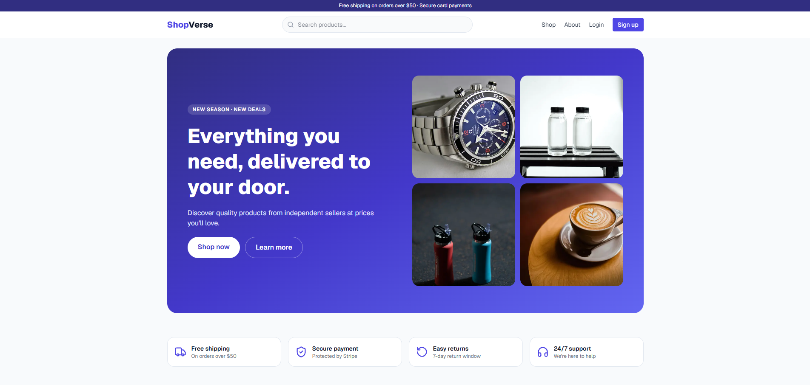 | 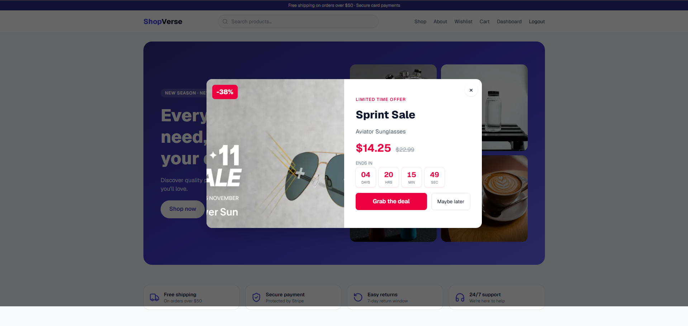 |
| 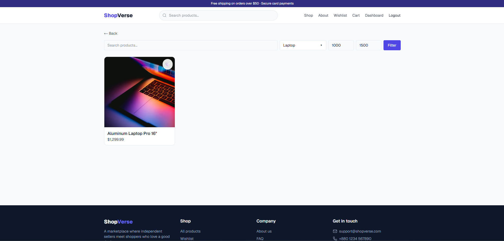 | 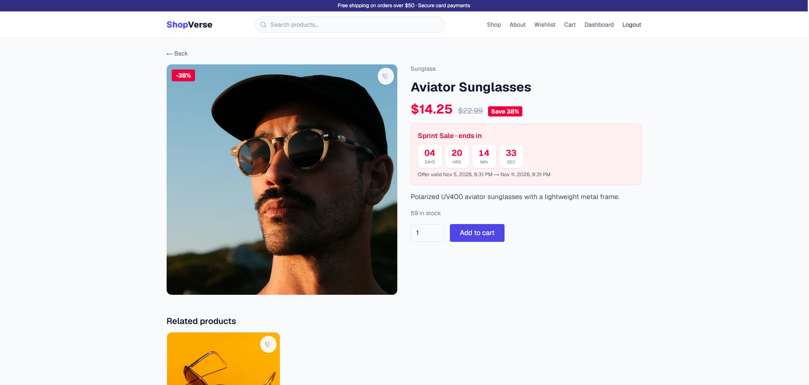 |
| 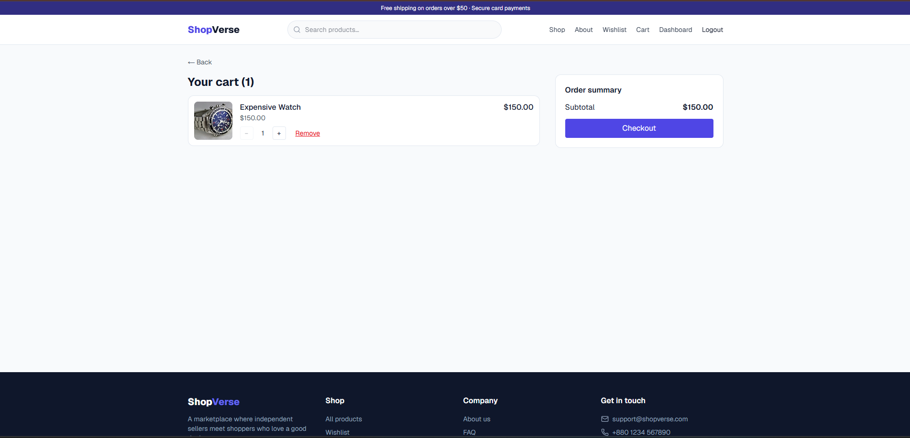 | 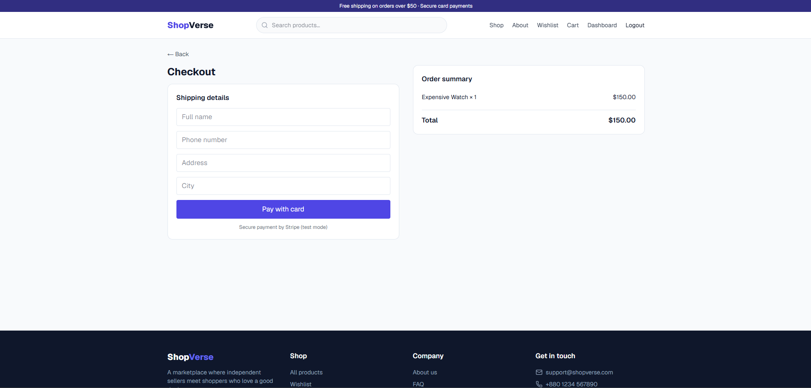 |
| 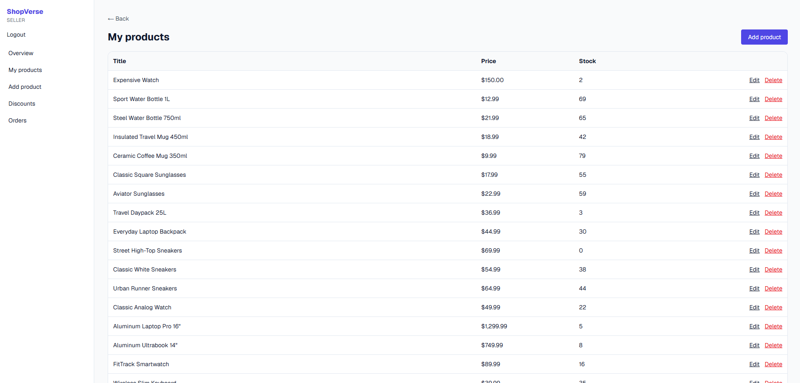 | 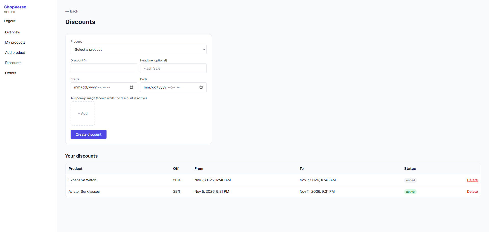 |
| 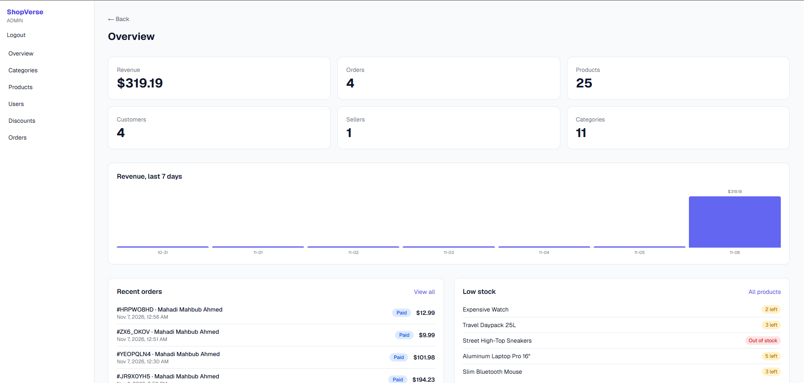 | 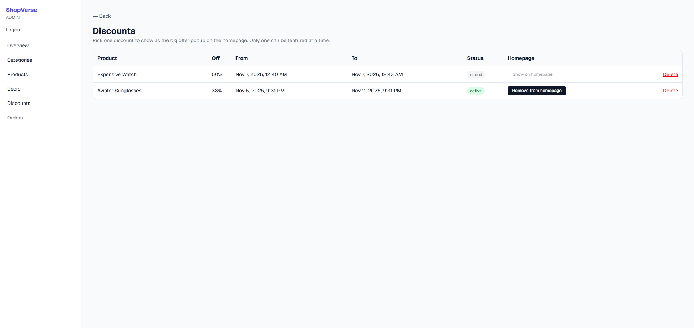 |
| 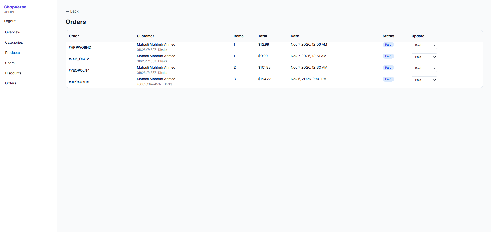 | 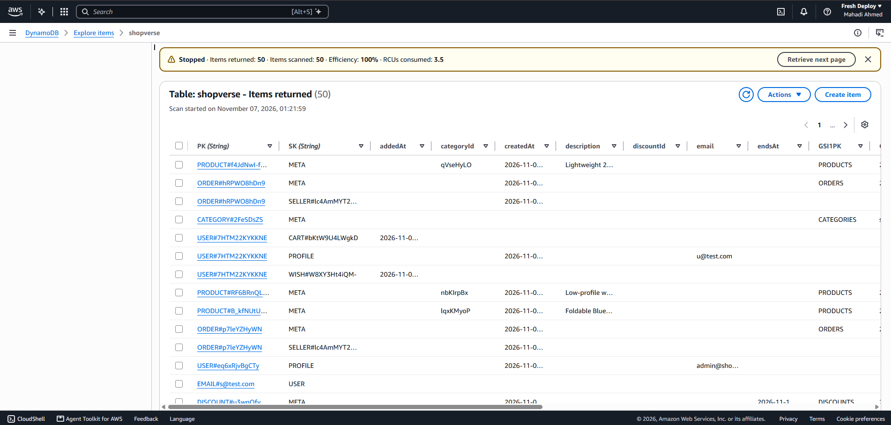 |